<p align="center">
  
</p>

Customizable MDX documentation framework for Next.js. Drop a folder of MDX files into your app and get a complete docs site with sidebar, search, theming, and LLM-ready outputs.

[](https://www.npmjs.com/package/pzzadocs)
[](https://nodejs.org/)
[](https://nextjs.org/)
[](https://www.typescriptlang.org/)
[](https://opensource.org/licenses/MIT)

## Installation

```bash
npm install pzzadocs
```

## Basic Usage

```ts
// docs.config.ts
import { defineConfig } from "pzzadocs";

export default defineConfig({
  title: "My Docs",
  baseUrl: "/docs",
  nav: { links: [{ text: "Overview", href: "/docs" }] },
});
```

```tsx
// app/docs/[[...slug]]/page.tsx
import { notFound } from "next/navigation";
import { createSource } from "pzzadocs";
import { DocsBody, DocsPage, DocsTitle } from "pzzadocs/ui";
import config from "@/docs.config";

const source = createSource(config);

export default async function Page({ params }: { params: Promise<{ slug?: string[] }> }) {
  const { slug = [] } = await params;
  const page = await source.getPage(slug);
  if (!page) notFound();
  const tree = await source.getPageTree();

  return (
    <DocsPage toc={page.toc} tree={tree} url={page.url}>
      <DocsTitle>{page.title}</DocsTitle>
      <DocsBody>{page.content}</DocsBody>
    </DocsPage>
  );
}
```

Write content in `content/docs/*.mdx`, order it with `meta.json`, and import `pzzadocs/styles.css` (and `pzzadocs/math.css` for formulas) once in your root layout.

## Core Features

- **File-based Content**: MDX and Markdown pages with frontmatter, `meta.json` ordering, route groups, root folders, and locales
- **Built-in Components**: Callout, Tabs, Steps, Cards, Accordion, Type Table, Files, Banner, and Image Zoom available in every page
- **Code Blocks**: Dual light and dark highlighting, line numbers, highlight and diff markers, tabbed fences, and package manager tabs
- **Diagrams and Math**: Mermaid fences render as theme-aware diagrams and TeX math renders with KaTeX
- **Search**: Structured client-side index over pages, headings, and paragraphs with a command palette
- **Theming**: Plain CSS tokens with presets, density, fonts, and radius configured from one object, no utility framework required
- **LLM Outputs**: `llms.txt`, `llms-full.txt`, per-page Markdown, and copy or open-in-assistant page actions
- **Server-first**: React Server Components, runtime MDX compilation with caching, static generation ready

## Documentation

For detailed documentation and guides, visit:
- [Official Documentation](https://docs.pzza.works)
- [Theming](https://docs.pzza.works/guides/theming)
- [Writing Content](https://docs.pzza.works/guides/content)

## Contributing

Contributions are welcome! Please feel free to submit a Pull Request.

1. Fork the repository
2. Create your feature branch (`git checkout -b feature/amazing-feature`)
3. Commit your changes (`git commit -m 'Add some amazing feature'`)
4. Push to the branch (`git push origin feature/amazing-feature`)
5. Open a Pull Request

## License

This project is licensed under the MIT License - see the [LICENSE](LICENSE) file for details.

## Contact

PzzaWorks - [https://pzza.works](https://pzza.works)

Project Link: [https://github.com/pzzaworks/pzza-docs](https://github.com/pzzaworks/pzza-docs)
